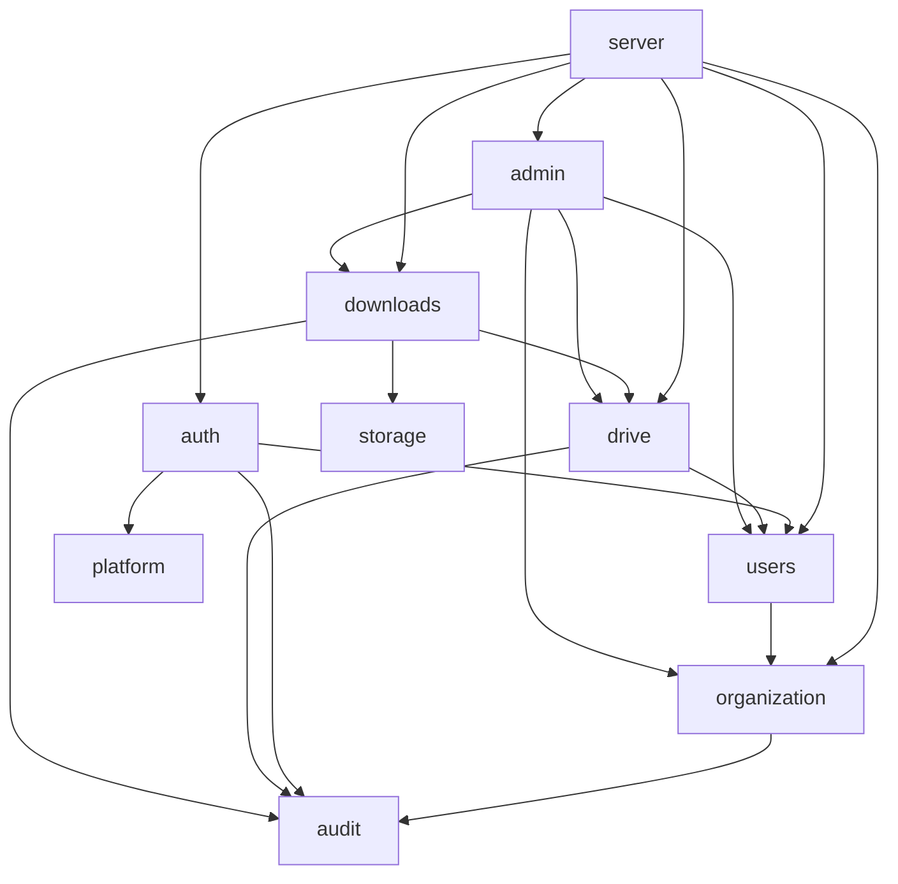

# Arquitectura del backend

## Organización

```
backend/
├── cmd/
│   ├── api/main.go        # HTTP
│   ├── worker/main.go     # cola y transferencias
│   ├── bootstrap/main.go  # primer administrador
│   └── migrate/main.go    # migraciones dentro del contenedor API
├── internal/
│   ├── auth/              # identidad, sesiones, CSRF, Turnstile, RBAC
│   ├── users/
│   ├── organization/
│   ├── drive/             # OAuth documental + adaptador Drive v3
│   ├── downloads/         # trabajos, cola, worker, progreso y archivos
│   ├── realtime/          # WebSocket, hub, LISTEN/NOTIFY y suscripciones
│   ├── storage/
│   ├── admin/
│   ├── audit/
│   ├── platform/
│   │   ├── config, db, apperr, httpx, logx, crypto,
│   │   ├── password, ratelimit, migrate, oauthstate,
│   │   ├── googleoauth, principal, validate
│   └── server/router.go
└── migrations/
```

Los módulos exponen tipos de dominio, un repositorio PostgreSQL y un servicio de casos de uso.
Los handlers traducen HTTP ↔ casos de uso; no contienen SQL ni reglas de negocio.

## Dependencias



`principal` no importa módulos de dominio, evitando ciclos. `drive` no decide autorización
administrativa; eso vive en `downloads.Create` y en las políticas HTTP.

## Frontend ↔ backend

| Contrato | Ubicación |
|---|---|
| Rutas | `internal/server/router.go` |
| DTOs de respuesta | tipos con tags JSON en cada módulo |
| Errores | `apperr` → `{"error":{code,message,fields}}` |
| Tiempo real | `realtime.Service` (`GET /api/v1/realtime`) |
| OpenAPI | `docs/api/openapi.yaml` |

## Reglas de diseño aplicadas

- `context.Context` en todas las operaciones de I/O.
- Errores tipados y traducción única a HTTP.
- Retornos tempranos y funciones pequeñas.
- Interfaces orientadas al consumidor solo donde hay variación real (p. ej. `httpx.Middleware`).
- SQL en repositorios, no en handlers.
- Migraciones con restricciones; reglas críticas también en PostgreSQL.
- Logger estructurado con `service` y `request_id`.
- Sin estado crítico en memoria: solo rate limits y el limitador de cuota (proceso único).

## Worker

- Procesa un trabajo a la vez; dentro usa un pool acotado por `WORKER_CONCURRENCY`.
- El límite por cuenta se comparte mediante `AccountLimiter` en el proceso.
- Heartbeat cada `WORKER_HEARTBEAT_SECONDS`; lease de `WORKER_LEASE_SECONDS`.
- La cancelación se detecta en el heartbeat y aborta `context` (incluye transferencia).
- Los errores se clasifican en transitorios, permanentes y reautenticación.
- Un lease perdido no modifica el trabajo; el nuevo propietario continúa.

## Configuración

`config.Load()` valida todo al arrancar: `POSTGRES_*` (construye el DSN interno), `SESSION_SECRET`,
OAuth, Turnstile y una clave AES de 32 bytes. La distribución local no exige HTTPS.
