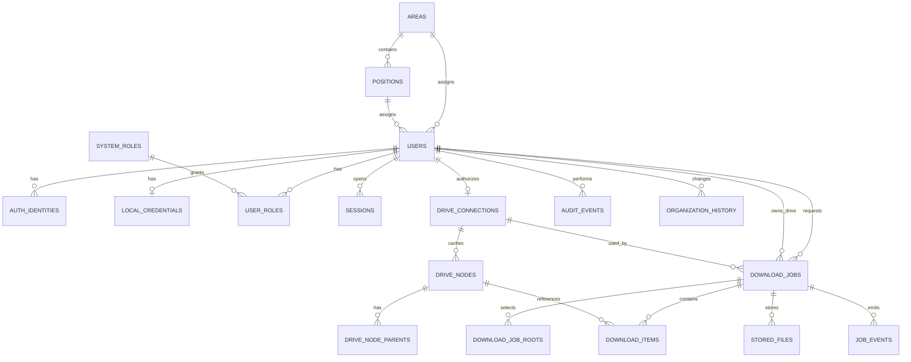

# Diseño de base de datos

Motor: PostgreSQL 18. Migraciones embebidas:

1. `0001_init.sql` — esquema completo, roles de sistema.
2. `0002_sessions_and_scan.sql` — checkpoint de escaneo, índice de espera y trigger de invalidación de sesiones.
3. `0003_drive_revision.sql` — revisión de Drive observada para `stored_files.source_revision_id`.
4. `0004_job_org_slug_snapshot.sql` — slugs del área/cargo congelados en el trabajo.

Los bytes de documentos **no** están en PostgreSQL. Solo metadatos, estados y rutas relativas.

## Diagrama

## Reglas de integridad clave

| Regla | Mecanismo |
|---|---|
| Un cargo pertenece a un área | `positions.area_id NOT NULL` + FK |
| El cargo del usuario pertenece a su área | FK compuesta `(position_id, area_id) → positions(id, area_id)` |
| Identidad Google única | `UNIQUE(provider, provider_subject)` |
| Una conexión Drive por trabajador | `UNIQUE(user_id)` |
| Una cuenta Google no se vincula a dos trabajadores | `UNIQUE(google_subject)` |
| Un nodo Drive por conexión | `UNIQUE(drive_connection_id, google_file_id)` |
| Un elemento por nodo y trabajo | `UNIQUE(job_id, drive_node_id)` |
| Ruta de documento única | `UNIQUE(relative_path)` en `stored_files` |
| Idempotencia | `UNIQUE(requested_by_user_id, idempotency_key)` |
| Snapshots y organización | columnas `*_snapshot` en `download_jobs` |
| Historial no destruido | FKs `ON DELETE RESTRICT`; sin cascadas sobre historial documental |
| Suspensión invalida sesiones | trigger `users_invalidate_sessions` |

## Tablas

### Organización

- `areas(id, name, slug, status, timestamps)`.
- `positions(id, area_id, name, slug, normalized_name, status, timestamps)`.
- `organization_history` conserva área/cargo anterior y nuevo, actor y fecha.

Los slugs se generan al crear y **no cambian al renombrar**, porque forman parte de las rutas
físicas de snapshots existentes.

### Identidad

- `users` incluye nombres, correo, área, cargo, estado y último acceso.
- `auth_identities` liga `provider_subject` (Google `sub`) a un usuario.
- `local_credentials` solo administradores; `password_hash` Argon2id PHC.
- `system_roles` (`admin`, `moderator`, `read_only`, `user`) y `user_roles`.
- `sessions` guarda hash SHA-256 del token, CSRF, expiración, user-agent e IP hasheada.
- `oauth_states` guarda hash del state, flujo, usuario, PKCE, expiración y consumo único.

### Drive y política

- `policy_versions(version UNIQUE, content, published_at, created_by_user_id)`.
- `drive_connections` incluye `google_subject`, refresh token cifrado, scopes, estado y consentimiento.
- `drive_nodes` conserva metadatos observados (nombre, MIME, tamaño, fechas, enlace, descripción, destacado, compartido, capacidad de descarga, atajos y revisión); `drive_node_parents` mantiene las relaciones padre-hijo actuales.
- `stored_files` referencia nodo, job, propietario, ruta relativa, MIME exportado, SHA-256 y estado.

### Trabajos y cola

- `download_jobs` incluye snapshots (`area_id_snapshot`, `position_id_snapshot`, nombres), solicitante,
  propietario, conexión, estado, contadores, bytes, idempotencia, cancelación y lease.
- `download_job_roots` conserva las raíces seleccionadas y la ruta mostrada.
- `download_items` conserva estado por archivo, intentos, próximo reintento, ruta relativa, hash y error.
- `job_events` es la cola de eventos SSE (no la fuente de verdad).
- `audit_events` registra actor, acción, objetivo, metadata JSON e IP hash.

## Índices principales

- Estados y antigüedad de trabajos: `(status, created_at)`, `(lease_expires_at)`.
- Trabajos por propietario/solicitante con fecha descendente.
- Elementos por job/estado y por `next_retry_at`.
- Sesiones por usuario y expiración.
- Auditoría por fecha y actor.
- `stored_files` por propietario, job y nodo.

## Transacciones

- Creación de trabajo + raíces: una transacción.
- Cancelación: bloqueo `FOR UPDATE`, estado y elementos pendientes.
- Reintento: reseteo de fallidos + estado del job.
- Marcado de archivo completado + `stored_files`: una transacción.
- Migraciones: transacción por archivo + advisory lock global.

## Retención

`RETENTION_DAYS` se aplica con `deploy/scripts/retention.sh` (dry-run por defecto). No hay
borrado automático silencioso. Para eliminar un snapshot se borran primero los archivos y luego
las filas dependientes, respetando las FKs.

## Raíces de archivo individuales

`download_job_file_roots` guarda las raíces de archivo de `selected_items`:

- `job_id` con borrado en cascada;
- `google_file_id`, nombre y ruta original congelados;
- índice único `(job_id, google_file_id)`.

Las carpetas siguen en `download_job_roots`. `download_jobs.scope_type` admite
`my_drive_full`, `selected_folders` (histórico) y `selected_items`.
