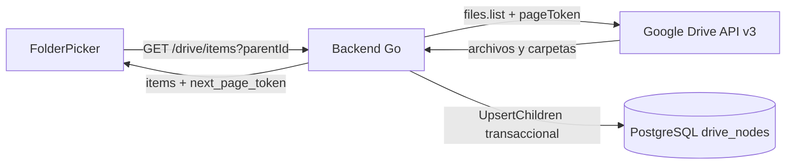
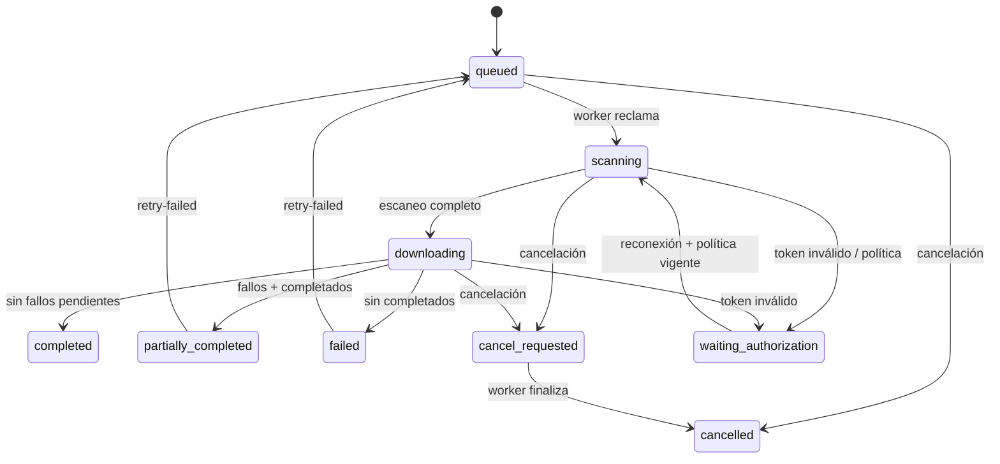

# Pipeline de descarga

## Exploración interactiva

El selector de `/app/admin/downloads` consulta Google Drive como fuente de verdad:



- Solo se consulta el contenido inmediato de la carpeta actual.
- La paginación usa `nextPageToken` opaco; no se recorre Mi unidad completo.
- Los archivos se muestran pero no se seleccionan como raíces.
- Los atajos se muestran como referencias y no se recorren.
- Si Google falla, la UI muestra el error y no presenta metadatos antiguos como actuales.
- PostgreSQL conserva la última observación para el pipeline; no sustituye a Drive.

## Estados



Trabajo: `queued`, `scanning`, `downloading`, `completed`, `partially_completed`, `failed`,
`waiting_authorization`, `cancel_requested`, `cancelled`.

Elemento: `pending`, `downloading`, `completed`, `skipped`, `retrying`, `failed`, `cancelled`.

## Reclamo de trabajos

```sql
WITH candidate AS (
  SELECT j.id
  FROM download_jobs j
  LEFT JOIN drive_connections c ON c.id = j.drive_connection_id
  WHERE j.status = 'queued'
     OR (j.status IN ('scanning','downloading','cancel_requested')
         AND (j.lease_expires_at IS NULL OR j.lease_expires_at < now()))
     OR (j.status = 'waiting_authorization'
         AND c.status = 'connected'
         AND c.refresh_token_ciphertext IS NOT NULL
         AND c.policy_consent_version = (SELECT version FROM policy_versions ORDER BY published_at DESC LIMIT 1))
  ORDER BY j.created_at
  FOR UPDATE OF j SKIP LOCKED
  LIMIT 1
)
UPDATE download_jobs ...
```

## Escaneo

1. Construye la raíz: `Mi unidad` completa o cada carpeta seleccionada validada con `PathToRoot`.
2. BFS por carpetas; `nextPageToken` se sigue hasta agotar resultados.
3. Cada hijo se registra en `drive_nodes` + `drive_node_parents`.
4. Carpetas: se crean localmente y se encolan.
5. Archivos: se crea un `download_item` (pendiente u omitido con razón).
6. Carpetas vacías quedan creadas.
7. `scan_completed_at` marca el checkpoint; un reinicio no reescanea.

Nombres repetidos: sufijo determinista `~<prefijo del ID>`; la identidad sigue siendo el ID.
Atajos: se registran como referencia omitida, sin recorrer el destino, evitando ciclos y copias.

## Descarga

- Cola de elementos `pending`/`retrying` cuyo `next_retry_at` ya venció.
- Pool de hasta `min(WORKER_CONCURRENCY, WORKER_PER_ACCOUNT_CONCURRENCY)`.
- `AccountLimiter` espacia **inicios** por conexión (`DOWNLOAD_MIN_INTERVAL_MS`), compartido.
- Binarios: `files.get` con media. Nativos: `files.export` a DOCX/XLSX/PPTX.
- Antes: `capabilities.canDownload`, tipo soportado, límite de archivo y capacidad.
- Streaming a `.part` en el directorio destino, SHA-256 + MD5, límite de bytes.
- Verificación de longitud y checksum; `fsync`, cierre y `rename` atómico.
- `stored_files` se inserta en la misma transacción que el estado `completed`.

## Reintentos

| Clasificación | Acción |
|---|---|
| 429 / quota / 5xx / red / checksum / transferencia incompleta | `retrying` con backoff exponencial + jitter, respetando `Retry-After` |
| 401 / `invalid_grant` | conexión `reauthorization_required`; trabajo `waiting_authorization`; elemento vuelve a `pending` |
| 403 sin permiso, no descargable, formato no soportado, 404 | `skipped` con código y razón |
| Agotar 5 intentos | `failed` con último error |
| Disco lleno / límite de capacidad | detener, fallar pendientes y finalizar |

Un error individual no detiene el trabajo; al final:

- todos correctos → `completed`
- fallos + completados → `partially_completed`
- solo fallos → `failed`
- pendientes inesperados → no se declara completado (`incomplete_items`)

## Cancelación

- `POST /download-jobs/{id}/cancel` marca `cancel_requested` (o `cancelled` si aún está en cola).
- El heartbeat del worker lee la marca y cancela el `context`.
- La transferencia en curso se aborta; el `.part` se elimina.
- Se cancelan pendientes y el trabajo finaliza `cancelled`.

## Recuperación

- Lease vencida → otro reclamo continúa desde `scan_completed_at`.
- Elementos ya completados no se vuelven a descargar (`UNIQUE(job_id, drive_node_id)` + estado).
- El escaneo es idempotente por upserts.
- Un lease perdido no finaliza el trabajo: el nuevo propietario lo retoma.

## SSE

- `snapshot` inicial con estado real de PostgreSQL.
- Eventos `job.*` e `item.*` desde `job_events`.
- `done` cuando el estado es terminal.
- `Last-Event-ID` permite reanudar.
- El frontend mantiene polling REST como respaldo.
