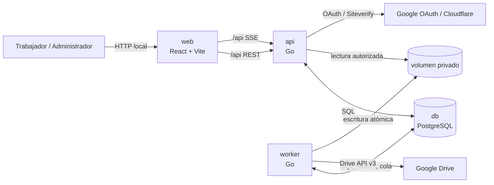
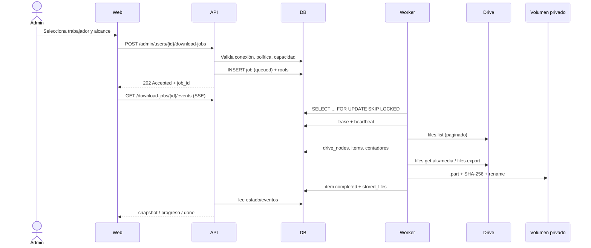

# Arquitectura general

TERRA separa cuatro responsabilidades en cuatro contenedores. La API nunca descarga documentos
masivamente y el worker nunca sirve HTTP.

## Principios

1. **PostgreSQL es la fuente de verdad.** El estado de un trabajo no vive en memoria ni en el navegador.
2. **Asincronía real.** `POST` de creación solo valida y encola; responde `202`.
3. **Identidad separada de autorización documental.** El login usa OIDC; el acceso al Drive usa un segundo consentimiento OAuth con `drive.readonly`.
4. **El administrador no suplanta al trabajador.** La conexión pertenece al trabajador y su `sub` se compara con la sesión.
5. **Estructura original preservada.** La clasificación municipal es una capa de directorios; debajo se reproduce Mi unidad.
6. **Escritura atómica y trazable.** `.part` → validación → `rename` → PostgreSQL.
7. **UI sin autoridad final.** Oculta acciones por permisos, pero el backend decide.

## Módulos backend

| Módulo | Responsabilidad |
|---|---|
| `auth` | OAuth de identidad, login local, sesiones, CSRF, Turnstile, RBAC, middleware |
| `users` | Perfil, estados y asignación vigente |
| `organization` | Áreas, cargos, historial organizativo |
| `drive` | OAuth Drive, conexión, metadatos, carpetas, exportación/descarga |
| `downloads` | Cola, trabajos, worker, SSE, documentos y acceso a archivos |
| `storage` | Rutas relativas, sanitización, contención, `.part`, rename, espacio libre |
| `admin` | Dashboard, trabajadores y auditoría administrativa |
| `audit` | Registro de operaciones sensibles |
| `platform` | Config, DB, errores, HTTP, cifrado, password, rate limit, migraciones |
| `server` | Cableado de rutas y límites de autorización |

## Flujo de un snapshot

## Decisiones que no se negocian

- Cuatro contenedores exactos.
- Sin Redis/RabbitMQ.
- Sin `drive.file` como sustituto de `drive.readonly`.
- Sin refresh tokens en el navegador.
- Sin borrado de historial al suspender/desactivar.
- Sin claves ni tokens en logs.
- Sin descargas dentro de una petición HTTP.

Véanse los ADR en `docs/decisions/`.
